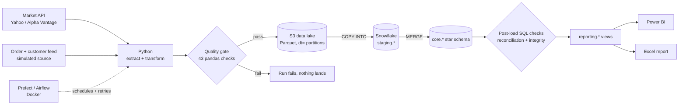
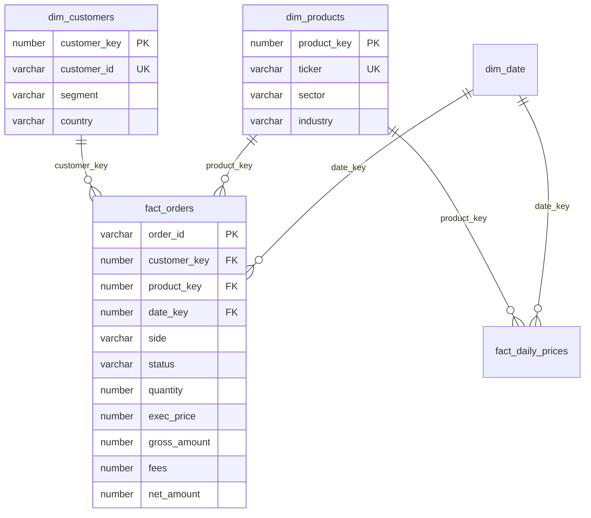

# Automated-Financial-Scraper

A batch ETL pipeline that pulls daily stock data from market APIs, lands it in **S3**, loads it into **Snowflake** staging tables, and models it as a **star schema** with automated data-quality gates. Orchestrated with **Prefect** (Airflow DAG included), packaged with **Docker**, reported through **Excel** and **Power BI**.

> Engineered a scalable batch ETL pipeline using Python, Prefect/Airflow, and Docker to automatically ingest daily order data into S3 and orchestrate transfers to Snowflake staging tables. Designed a dimensional star schema (`fact_orders`, `dim_customers`, `dim_products`) in Snowflake and integrated automated data quality checks to ensure reliable, high-integrity financial reporting.

## Architecture



**One run = one trading day.** Re-running a day is always safe: S3 files are overwritten, staging is truncated, and every load is a `MERGE` on the business key.

## Data model (Snowflake `FIN_SCRAPER` database)



| Schema | Objects |
|---|---|
| `staging` | `stg_prices`, `stg_products`, `stg_customers`, `stg_orders` (transient, reloaded each run) |
| `core` | `fact_orders`, `fact_daily_prices`, `dim_customers`, `dim_products`, `dim_date` |
| `reporting` | `vw_orders_enriched`, `vw_daily_order_summary`, `vw_ticker_performance` |
| `ops` | `etl_run_audit` (one row per run: status, row counts, error) |

Here "orders" are **securities trade orders**: customers are brokerage accounts, products are tickers, and each order is a BUY/SELL that is `FILLED`, `CANCELLED` or `REJECTED`. Fees depend on customer segment (retail 0.10%, professional 0.05%, institutional 0.02%, $1 minimum).

> **About the data:** prices are real (Yahoo Finance / Alpha Vantage). No public brokerage order feed exists, so `simulator.py` generates deterministic customers and orders priced inside each day's real high/low range. To use a real source, replace `extract_customers` / `extract_orders` with an API call or DB export returning the same columns; nothing downstream changes.

## Data quality

**Before landing (pandas, 43 checks):** not-null keys, uniqueness of business keys, accepted values (`side`, `status`, `segment`), numeric ranges, OHLC consistency (`high >= open/close >= low`), referential integrity (orders to customers/products, prices to products), ticker coverage (<80% blocks the run, any gap warns), `net_amount = gross ± fees` reconciliation, and executions inside the day's price range (warning). Any critical failure raises `DataQualityError` and **nothing is written to S3**.

**After loading (Snowflake SQL, 12 checks):** staging vs. fact row counts, filled-notional reconciliation, no duplicate `order_id`, no orphan dimension keys, valid filled amounts, net-amount identity, `date_key` matches the batch, unique business keys on both dimensions. Failures write a `FAILED` row to `ops.etl_run_audit` and fail the Prefect run.

## Quickstart (no accounts needed)

```bash
pip install -r requirements-dev.txt
make test         # 50 tests: transforms, quality gate, SQL parsing, full Prefect flow
make run-local    # synthetic prices, Parquet lands under ./data/lake/raw/...
make backfill-local   # a two-week backfill
```

Use real prices by copying `.env.example` to `.env` (`PRICE_PROVIDER=yahoo` needs no key) and running `python -m fin_scraper run --date 2024-06-03`.

## Production setup (AWS + Snowflake)

1. **S3:** create a bucket; set `LOAD_TARGET=s3`, `S3_BUCKET`, and AWS credentials (env vars, mounted `~/.aws`, or a task/instance role).
2. **Snowflake:** run `sql/00_setup_infra.sql` once as `ACCOUNTADMIN` (replace `<BUCKET>`, `<AWS_ROLE_ARN>`, `<PASSWORD>`). It creates the role, warehouse, database, schemas, a **storage integration** and an external stage.
3. **IAM trust:** `DESC INTEGRATION FIN_S3_INT;` returns `STORAGE_AWS_IAM_USER_ARN` and `STORAGE_AWS_EXTERNAL_ID`; put those in the trust policy of the IAM role (read access to `s3://<BUCKET>/raw/*`). No AWS keys are ever stored in Snowflake.
4. Fill the `SNOWFLAKE_*` vars in `.env`, set `LOAD_SNOWFLAKE=true`, then `make bootstrap` to create tables and views.
5. `python -m fin_scraper run --date 2024-06-03 --export-excel` runs the whole chain.

## Orchestration

**Prefect (default).** `docker compose up -d --build` starts a Prefect server (UI at http://localhost:4200) and a container that registers the `daily-financial-etl` deployment on a weekday schedule (06:00 New York, Tue-Sat; each run loads the previous business day). Extract tasks run in parallel with retries and backoff; exchange holidays produce an empty response and the run is skipped cleanly rather than failed.

**Airflow (alternative).** `dags/financial_etl_dag.py` wraps the same functions in three tasks (extract/validate/land, load Snowflake). Install the package in your Airflow image and set the same env vars.

## Excel and Power BI

* **Excel:** `--export-excel` writes `data/exports/daily_report_<date>.xlsx` (daily summary, ticker performance, top customers) from the reporting views.
* **Power BI:** *Get Data > Snowflake*, server `<account>.snowflakecomputing.com`, warehouse `FIN_ETL_WH`, database `FIN_SCRAPER`, then pick the three `reporting` views (Import or DirectQuery). Because Excel and Power BI both read the same views, their numbers always agree.

## Repository layout

```
src/fin_scraper/
  config.py       settings from env          extract.py     Yahoo / Alpha Vantage / synthetic providers
  simulator.py    customer + order source    transform.py   fees, net amounts, normalisation
  quality.py      pandas + SQL checks        lake.py        Parquet to S3 (or local)
  warehouse.py    Snowflake wrapper + audit  pipeline.py    orchestrator-agnostic steps
  flows.py        Prefect flow + tasks       report.py      Excel export
sql/              00 admin setup, 01-03 DDL, 10-30 per-run load scripts
dags/             Airflow DAG                tests/         50 tests (pytest)
Dockerfile, docker-compose.yml, Makefile, .github/workflows/ci.yml
```

## Design decisions

* **Parquet + `COPY INTO ... MATCH_BY_COLUMN_NAME`** keeps types intact and makes schema drift fail loudly instead of silently shifting columns.
* **Validate before landing**, so the lake never contains data that failed the gate.
* **MERGE everywhere** for idempotency, which makes retries and backfills safe.
* **Surrogate keys** (`IDENTITY`) on dimensions, with business keys uniquely constrained. Snowflake does not enforce constraints, so integrity is verified by the post-load checks.
* **Transient staging tables** avoid fail-safe storage cost for data that is reloaded daily.
* **Audit table** gives run history independent of the orchestrator.

## Verification status

The pandas layer, transforms, quality gate, Parquet landing, Excel writer and the Prefect flow are covered by automated tests (run in CI). Every Snowflake SQL file and quality query is parsed against the Snowflake dialect in tests, but the S3 and Snowflake steps have not been executed against live accounts here, so expect to adjust names/grants on first run.

## Ideas for next steps

SCD Type 2 on `dim_customers` (segment changes over time), dbt for the transform layer, Great Expectations or Soda for richer data-quality reporting, Terraform for the AWS/Snowflake setup, Snowpipe for continuous ingestion, alerting on failed runs (Prefect automations to Slack).
